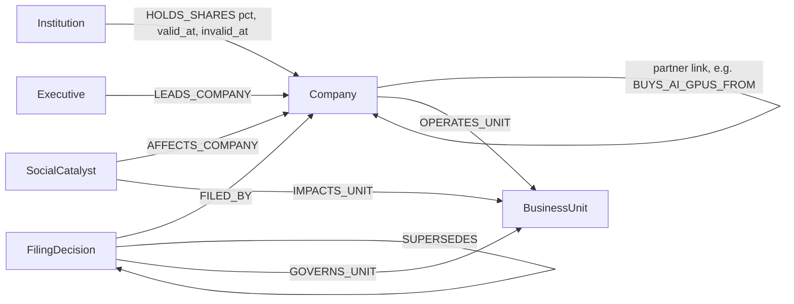
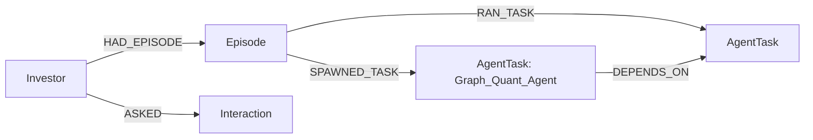

# FinGraph Sentinel

**Graph Hacks (WeMakeDevs x FalkorDB). Tracks: 1 Agents That Act on Connected Data, 2 Agent Memory and Coordination, 3 Company Brain.**

An agent that investigates a public company through a FalkorDB graph: who owns it, which counterparties it depends on,
what its filings say and how they changed, what the news is, and what each investor tenant already asked. Every answer
shows the graph path and its source (SEC filing link, news provider, or a `synthetic` label).

## What each track demonstrates

| Track | Graph work (not decoration) | Where |
|---|---|---|
| 1. Connected data | Shared-shareholder **contagion**: an institution holding both a company and its supply-chain counterparty (3-hop pattern); catalyst -> business unit -> governing filing; deterministic **recommended actions** from those paths | `queries.py` `Q_EXPOSURE`, `Q_TRACE`; `server.propose_actions` |
| 2. Memory and coordination | One **isolated graph per tenant**. Each harvest records the 4 agents' real outcomes; the Quant agent is **unlocked by `DEPENDS_ON` edges** only when upstream agents completed, and is closed when the chat agent answers. Questions are remembered and recalled into the next prompt | `memory.py`, `queries.py` `Q_MEMORY` |
| 3. Company brain | Real **SEC EDGAR** 10-K/10-Q filings, each linked `[:SUPERSEDES]` to the previous filing of the same form, with a clickable source URL; executives; temporal shareholder edges (`valid_at`/`invalid_at`) that expire when a holder disappears | `ingest_company.py`, `Q_LINEAGE` |

Without FalkorDB the product returns nothing: exposure, lineage, handoffs and recall are all graph traversals.

## Data model

Per-tenant memory graph (one per tenant, e.g. `investor_memory_tenant_1`):


## Run it
```powershell
docker run -d --name falkordb -p 6379:6379 -p 3000:3000 -v falkordb_data:/data falkordb/falkordb:latest
python -m venv .venv ; .\.venv\Scripts\Activate.ps1
pip install -r requirements.txt
copy .env.example .env          # set SEC_USER_AGENT (name + email), optionally OPENROUTER_API_KEY
python scripts/check_connection.py
uvicorn server:app --reload     # http://localhost:8000   (FalkorDB Browser: http://localhost:3000)
```
Or: `docker compose up --build`. CLI X-ray: `python query_agent.py GOOGL hedge_fund_alpha_graph`.
Tests (no DB or network needed): `python -m pytest -q`.

**Upgrading from the first version:** clear the old graphs once so the previous placeholder filings and shared-memory data
do not linger: `docker exec -it falkordb redis-cli GRAPH.DELETE fin_company_brain` (and the `investor_memory_*` graphs).

## Key Cypher
All queries are in [`queries.py`](queries.py), each with a plain-English comment. Loaders and updates are in
`ingest_company.py` and `memory.py`.

## Data sources and rules compliance
- **SEC EDGAR** (public domain), **Yahoo Finance via yfinance**, **Google News RSS** headlines. Reddit is **off** by default (`ENABLE_REDDIT=1` to opt in; check its API terms).
- No private, login-protected, paywalled or personal data is loaded.
- If a live provider is unavailable, a few demo tickers fall back to **synthetic** records, labelled `synthetic_fallback` in the graph and the UI.
- Business units are an **illustrative two-segment model** (no free API provides segments), labelled `synthetic_segment`.
- Supply-chain links come from a small **curated demo map** (`ECOSYSTEM_MAP`); unknown tickers get no invented partners.
- Sentiment is a keyword heuristic, not a model.

## Security notes
- Tickers and tenants are validated; tenants are an allow-list, so a request cannot select an arbitrary graph.
- Web-sourced text is HTML-escaped in the UI and wrapped as untrusted data in the LLM prompt (prompt-injection defence).
- Harvesting is `POST /api/harvest/{ticker}` with a per-ticker lock and a refresh cooldown.

## AI usage disclosure
Parts of this project were written with AI assistance (Claude): the first version's structure, and the audit fixes in this
version. The team reviewed and ran the code and can explain the graph model, queries and architecture. TODO: add names and what each person owns.

## Known limitations
Free market-data APIs rate-limit; the contagion view is only as complete as the holders data; no graph algorithms such as
PageRank are used yet (a natural next step: institution centrality across all tracked companies).
